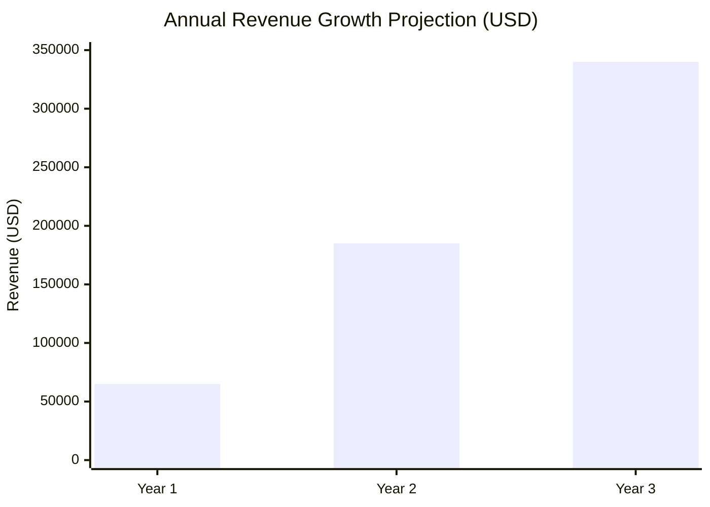

# CashFlow — Financial Forecast & Revenue Projections (Year 1 to 3)

---

### 1. Key Unit Economics & Model Assumptions

| Metric | Conservative | Target (Realistic) | Aggressive |
| :--- | :---: | :---: | :---: |
| **Monthly Organic Downloads (Month 12)** | 2,500 | 8,000 | 25,000 |
| **Total Cumulative Active Users (Year 1)** | 18,000 | 55,000 | 180,000 |
| **Free-to-Paid Conversion Rate** | 2.5% | **4.0%** | 6.0% |
| **Pro Monthly Price** | $2.49/mo | **$2.49/mo** | $2.99/mo |
| **Pro Annual Price** | $24.00/yr | **$24.00/yr** | $29.00/yr |
| **Lifetime Purchase Ratio** | 35% of buyers | **40% of buyers** | 45% of buyers |
| **Gross Margin (SaaS Software)** | 91% | **94%** | 96% |

---

### 2. Year 1 Financial Forecast (Target Scenario)

```
Month 1-3 (Seed Phase):
  • Cumulative Users: 5,000
  • Paid Users (4%): 200 (120 Sub / 80 Lifetime)
  • Monthly Recurring Revenue (MRR): ~$300/mo
  • Lifetime Upfront Cash: 80 × $34.99 = $2,799
  • Total Revenue Quarter 1: ~$3,700

Month 4-6 (Growth Phase - Cloud Sync + AI Scanner Launch):
  • Cumulative Users: 18,000
  • Total Paid Customers: 720 (430 Sub / 290 Lifetime)
  • Monthly Recurring Revenue (MRR): ~$1,070/mo
  • Total Revenue Quarter 2: ~$13,500

Month 7-12 (Scale Phase - Play Store Ranking + Shared Wallets):
  • Cumulative Users: 55,000
  • Total Paid Customers: 2,200 (1,320 Sub / 880 Lifetime)
  • Monthly Recurring Revenue (MRR): ~$3,280/mo (ARR: ~$39,360)
  • Lifetime License Revenue: 880 × $34.99 = $30,790
  • AI Scan Packs & Affiliate Deals: ~$4,200
  ────────────────────────────────────────────────────────
  ★ Year 1 Gross Revenue: ~$58,000 – $75,000 USD
  ★ Server & Cloud Costs: ~$1,800/year (Render + Go + Cloudflare)
  ★ Net Profit Margin: > 92%
```

---

### 3. Year 2 & Year 3 Scale Projections



- **Year 2 Projection:**
  - Active Users: ~160,000
  - Paying Customers: ~6,400
  - Annual Revenue: **~$185,000 USD** (MRR: ~$12,500/mo)
- **Year 3 Projection:**
  - Active Users: ~350,000+
  - Paying Customers: ~14,000
  - Annual Revenue: **~$340,000 – $450,000 USD** (MRR: ~$28,000/mo)

---

### 4. Why This Model Is Ultra-Profitable
- **Zero Inventory / Pure Digital:** Software delivery has zero marginal cost per user.
- **Go Backend Efficiency:** The Go backend handles 10,000 requests/sec on a $10/month VPS with minimal RAM/CPU.
- **Offline Storage Offloads Cloud Load:** Free users use zero cloud server resources (their data is saved locally on their phone/browser), meaning free users cost you **$0.00** while generating 5-star ratings and viral referrals!
